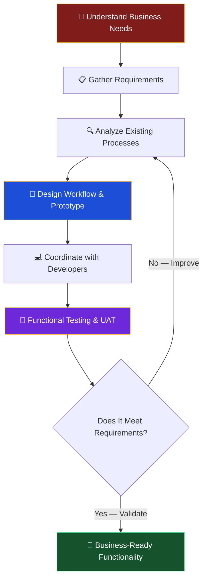

<!--
SENTHAMIL SELVAN S. | ERP FUNCTIONAL CONSULTANT
Replace YOUR_GITHUB_USERNAME with your actual GitHub username.
-->

---

## 🌌 WELCOME TO THE MULTIVERSE

---

## 🦸 MY ORIGIN STORY

I'm **Senthamil Selvan S.**, an **ERP Functional Consultant** passionate about understanding business operations and transforming real-world requirements into practical ERP solutions.

My role connects business users and technical development teams. I work on requirement gathering, process analysis, workflow design, functional prototyping, testing, bug identification, and continuous improvement.

My professional journey combines an engineering background with hands-on experience in administration and ERP functional consulting.

> *"Every great system starts with understanding the people who use it."*

---

## 🦾 MY SUPERPOWERS (ERP EDITION)

| Hero | Universe | ERP Superpower |
|:---:|:---:|:---|
| 🤖 **Iron Man** | Marvel | Rapid functional prototyping & AI-assisted design |
| 🛡️ **Captain America** | Marvel | Standing by the business requirement, always |
| 🕷️ **Spider-Man** | Marvel / Sony | Sensing bugs and validation gaps before they hit production |
| 🧙 **Doctor Strange** | Marvel | Seeing every possible workflow outcome |
| 🦇 **Batman** | DC | Preparing for every edge case and failure scenario |
| ⚡ **The Flash** | DC | Fast turnaround on change requests |
| 🔱 **Wonder Woman** | DC | Truth-seeking in requirement gathering |
| 🌌 **Spider-Verse** | Sony | Connecting seven ERP domains across the multiverse |

---

## 🎬 MY CAREER JOURNEY

<table>
<tr>
<td width="25%" align="center">

**2026 — PRESENT**

</td>
<td>

### 🔥 ERP Functional Consultant
**Meena Fibre Industry Private Limited**

- Gather and analyze ERP requirements across seven functional areas.
- Study existing business processes and translate them into ERP workflows.
- Coordinate between business users and developers.
- Create functional prototypes and UI concepts using AI-assisted tools, including Google AI Studio.
- Coordinate module development and clarify requirements.
- Perform functional testing and User Acceptance Testing (UAT).
- Identify bugs, missing fields, validation gaps, and workflow issues.
- Manage change requests and validate completed functionality.
- Suggest practical improvements to business processes.

</td>
</tr>
<tr>
<td align="center">

**MAY 2024 — SEP 2024**

</td>
<td>

### ⚡ Admin Executive — Contract
**Genius HR Tech**

Client / Work Location: **Vedantu Innovation Private Limited**

- Supported administrative and operational coordination.
- Maintained records and documentation.
- Coordinated with internal teams and stakeholders.
- Supported day-to-day operational requirements.

</td>
</tr>
<tr>
<td align="center">

**2021 — 2024**

</td>
<td>

### 🎓 Bachelor of Technology
**Electrical and Electronics Engineering (B.Tech EEE)**

Dr. M.G.R. Educational and Research Institute

</td>
</tr>
<tr>
<td align="center">

**2018 — 2021**

</td>
<td>

### 🎓 Diploma
**Electrical and Electronics Engineering (DEEE)**

T.J.S. Polytechnic College

</td>
</tr>
</table>

---

## ⚙️ THE SEVEN ERP DOMAINS — MY AVENGERS ASSEMBLE

These are the seven functional areas I support through ERP requirement analysis, workflow coordination, and functional validation.

---

## 🧠 MY CORE SKILLS

---

## 🛠️ HOW I TURN REQUIREMENTS INTO SOLUTIONS

---

