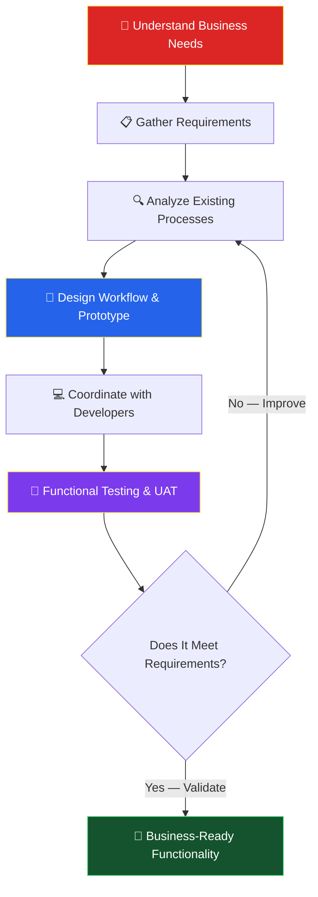

<!-- Replace YOUR_GITHUB_USERNAME below. Keep the "assets" folder next to this README. -->

 

---

## 💥 ISSUE #1 — ORIGIN STORY

I'm **Senthamil Selvan S.**, an **ERP Functional Consultant** who turns real business problems into working ERP solutions.

I connect business users with development teams: requirement gathering, process analysis, workflow design, functional prototyping, testing, bug hunting, and continuous improvement.

> *"Every great system starts with understanding the people who use it."*

---

## 🥊 ISSUE #2 — THE BUG BATTLE

Every release, a **Bug** shows up. Functional testing and UAT are how I send it flying.

---

## 🎬 ISSUE #3 — CAREER JOURNEY

<table>
<tr>
<td width="25%" align="center">

**2026 — PRESENT**

</td>
<td>

### 🔥 ERP Functional Consultant
**Meena Fibre Industry Private Limited**

- Gather and analyze ERP requirements across seven functional areas.
- Study existing business processes and translate them into ERP workflows.
- Coordinate between business users and developers.
- Create functional prototypes and UI concepts using AI-assisted tools, including Google AI Studio.
- Coordinate module development and clarify requirements.
- Perform functional testing and User Acceptance Testing (UAT).
- Identify bugs, missing fields, validation gaps, and workflow issues.
- Manage change requests and validate completed functionality.
- Suggest practical improvements to business processes.

</td>
</tr>
<tr>
<td align="center">

**MAY 2024 — SEP 2024**

</td>
<td>

### ⚡ Admin Executive — Contract
**Genius HR Tech**

Client / Work Location: **Vedantu Innovation Private Limited**

- Supported administrative and operational coordination.
- Maintained records and documentation.
- Coordinated with internal teams and stakeholders.
- Supported day-to-day operational requirements.

</td>
</tr>
<tr>
<td align="center">

**2021 — 2024**

</td>
<td>

### 🎓 Bachelor of Technology
**Electrical and Electronics Engineering (B.Tech EEE)**

Dr. M.G.R. Educational and Research Institute

</td>
</tr>
<tr>
<td align="center">

**2018 — 2021**

</td>
<td>

### 🎓 Diploma
**Electrical and Electronics Engineering (DEEE)**

T.J.S. Polytechnic College

</td>
</tr>
</table>

---

## ⚙️ ISSUE #4 — THE SEVEN ERP DOMAINS

Production • Inserts • Painting • Assembly • Dispatch • Store & Inventory • Tender — I support each through requirement analysis, workflow coordination, and functional validation.

---

## 🧠 ISSUE #5 — SUPERPOWERS

---

## 🛠️ ISSUE #6 — THE MISSION PLAN

---

## 🍌 BONUS EPISODE — EVEN HEROES SLIP

*"I am not just a consultant. I am the one who finds the missing field before go-live."*

