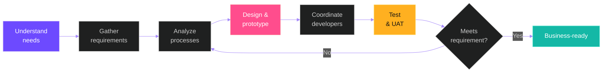

<!-- Replace YOUR_GITHUB_USERNAME, YOUR_EMAIL and YOUR_LINKEDIN. No other files needed. -->

 

## About

I’m **Senthamil Selvan S.**, an **ERP Functional Consultant** at **Meena Fibre Industry Private Limited**. I turn real business problems into working ERP solutions.

I connect business users with development teams: requirement gathering, process analysis, workflow design, functional prototyping, testing, bug hunting and continuous improvement. My background is in electrical and electronics engineering, with hands-on experience in administration and ERP functional consulting.

> *“Every great system starts with understanding the people who use it.”*

## What I do

<table>
<tr>
<td width="33%"></td>
<td width="33%"></td>
<td width="33%"></td>
</tr>
<tr>
<td></td>
<td></td>
<td></td>
</tr>
</table>

## Seven ERP domains

I support each area through requirement analysis, workflow coordination and functional validation.

## How I work

## Journey

<table>
<tr>
<td width="22%" align="center"><b>2026 — Present</b></td>
<td>

**ERP Functional Consultant** · Meena Fibre Industry Private Limited

- Gather and analyze ERP requirements across seven functional areas.
- Translate existing business processes into ERP workflows.
- Create prototypes and UI concepts with AI-assisted tools, including Google AI Studio.
- Coordinate module development; run functional testing and UAT.
- Identify bugs, missing fields and validation gaps; manage change requests.

</td>
</tr>
<tr>
<td align="center"><b>May 2024 — Sep 2024</b></td>
<td>

**Admin Executive (Contract)** · Genius HR Tech
Client: Vedantu Innovation Private Limited

- Supported administrative and operational coordination, records and documentation.

</td>
</tr>
<tr>
<td align="center"><b>2021 — 2024</b></td>
<td>

**B.Tech, Electrical and Electronics Engineering** · Dr. M.G.R. Educational and Research Institute

</td>
</tr>
<tr>
<td align="center"><b>2018 — 2021</b></td>
<td>

**Diploma, Electrical and Electronics Engineering** · T.J.S. Polytechnic College

</td>
</tr>
</table>

## Contact

